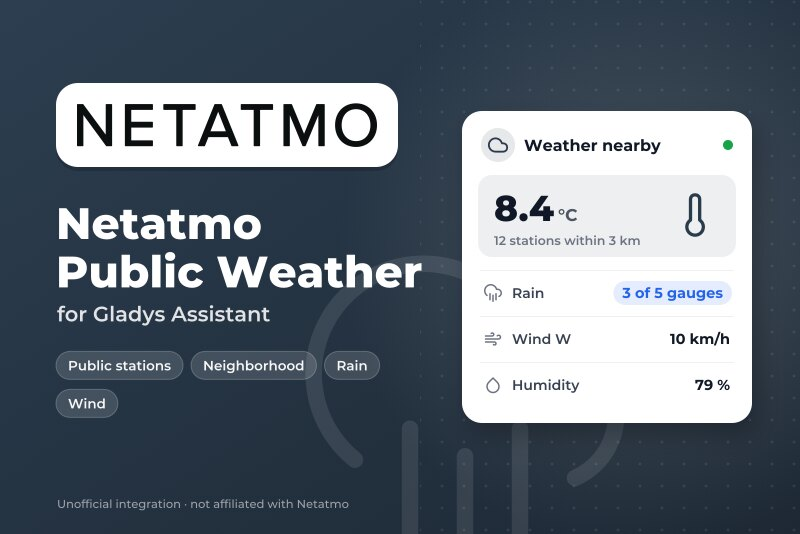
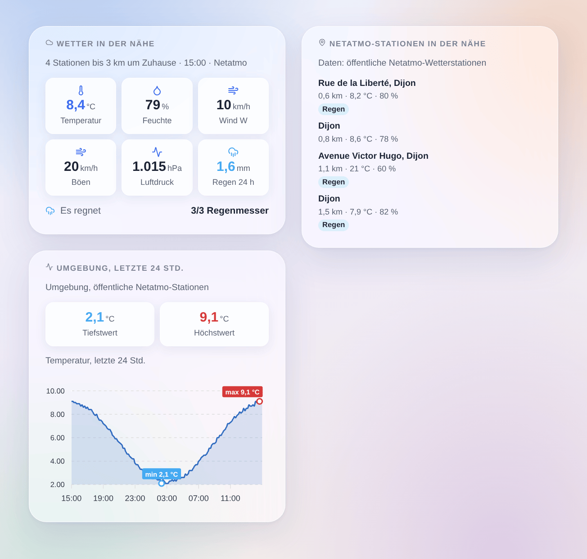
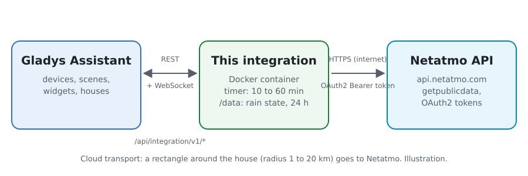
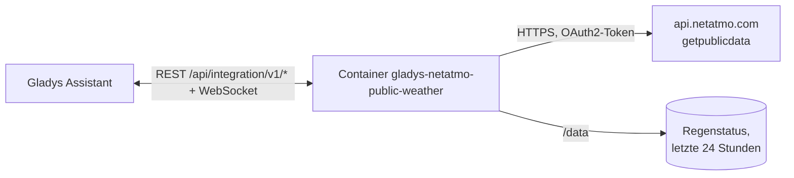
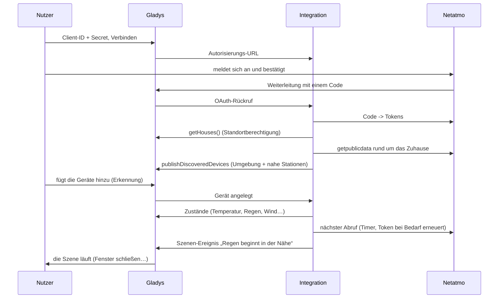

# Gladys Netatmo Public Weather

[English](README.md) · [Français](README.fr.md) · **Deutsch** · [Español](README.es.md)

[](LICENSE)
[](https://github.com/William-De71/gladys-netatmo-public-weather/releases)
[](https://github.com/William-De71/gladys-netatmo-public-weather/actions/workflows/release.yml)
[](https://gladysassistant.com)



Externe [Gladys-Assistant](https://gladysassistant.com)-Integration für die **öffentlichen Netatmo-Wetterstationen**: Tausende Besitzer teilen ihre Station, und Gladys macht aus denen rund um dein Zuhause das Wetter deiner Umgebung (Regen, Wind, Temperatur), mit Szenen, wenn der Regen beginnt oder aufhört. Kein Netatmo-Gerät nötig: ein kostenloses Netatmo-Konto und deine eigene Netatmo-Connect-Anwendung reichen.

## Funktionen

- **Das Wetter der Umgebung** (ein Gerät): Temperatur, Luftfeuchtigkeit, Luftdruck, Regen der letzten Stunde und in 24 Stunden, Wind, Böe und Richtung, Regen ja/nein und Anzahl der genutzten Stationen. Median der Stationen im Radius (1 bis 20 km) oder ihr Mittelwert.
- **Die nächsten Stationen** (bis zu 20 Geräte): die Messwerte ihrer Module (Außenmodul, Regenmesser, Windmesser) und ihre Entfernung vom Zuhause.
- **Szenen-Auslöser**: Regen beginnt in der Nähe, Regen hört in der Nähe auf.
- **Szenen-Aktion**: das Wetter in der Nähe jetzt abrufen, mit dem Radius deiner Wahl (Ausgaben für Benachrichtigungen und Bedingungen).
- **Widgets**: Wetter in der Nähe, nahe Stationen, die Umgebung in den letzten 24 Stunden (Temperatur, Feuchte, Luftdruck, Wind oder Regen).
- Deutsch, Englisch, Französisch und Spanisch.



## Funktionsweise







### Transport

`transports: ["cloud"]`: alles geht per HTTPS an `api.netatmo.com`. Netatmo erhält ein Rechteck um das Zuhause (den Kreis des Radius) und dein Zugriffstoken; die Tokens bleiben in der Konfiguration von Gladys, nie in `/data` oder in den Logs. `/data` speichert, ob es beim letzten Abruf regnete, und die Umgebung der letzten 26 Stunden.

## Geräte und Funktionen

| Gerät                             | Funktionen                                                                                                                                         |
| --------------------------------- | -------------------------------------------------------------------------------------------------------------------------------------------------- |
| Netatmo-Wetter um _Zuhause_       | Temperatur (°C), Feuchte (%), Luftdruck (hPa), Regen 1 h (mm/h), Regen 24 h (mm), Wind und Böe (km/h), Richtung (°), es regnet, genutzte Stationen |
| Netatmo _Straße, Ort_ (Stationen) | die Messwerte der Module der Station, es regnet (Regenmesser), Entfernung vom Zuhause (km)                                                         |

Nur lesend. Ein Wert, den Netatmo nicht liefert (kein Windmesser in der Nähe, Station seit über einer Stunde offline), wird nicht veröffentlicht. „Es regnet“ ist ja, wenn mindestens ein Drittel der Regenmesser im Radius (mindestens einer) in den letzten Minuten oder der letzten Stunde Regen gemessen hat.

## Szenen-Auslöser, Aktionen und Widgets

- **Netatmo: Regen beginnt in der Nähe**, **Netatmo: Regen hört in der Nähe auf** (nach zwei trockenen Abrufen in Folge). Variablen: Zuhause, Regenmesser mit Regen, Regenmesser in der Nähe, Regen in 1 h und 24 h, Temperatur, Zusammenfassung, Gerät.
- **Netatmo: Wetter in der Nähe abrufen** (Aktion): Radius (optional) → Stationen, Temperatur, Feuchte, Luftdruck, Regen 1 h und 24 h, Wind, Böen, Richtung, es regnet, Zusammenfassung.
- Widgets: **Wetter in der Nähe**, **Netatmo-Stationen in der Nähe**, **Umgebung, letzte 24 Std.** (Einstellung: der Messwert).

Beispiele:

- Wenn der Regen in der Nähe beginnt → Dachfenster schließen und „{{triggerEvent.data.summary}}“ senden.
- Wenn der Regen in der Nähe aufhört → den Bewässerungsplan des Gartens fortsetzen.
- Jeden Abend um 22:00 → Wetter in der Nähe abrufen; unter 1 °C → „Frost heute Nacht“ melden.

## Voraussetzungen

- Gladys Assistant 5.3.0 oder neuer (ältere Instanzen können die Integration nicht installieren).
- Ein Zuhause mit Position in Gladys (Einstellungen → Häuser).
- Ein kostenloses Netatmo-Konto und eine Netatmo-Connect-Anwendung (dev.netatmo.com, 2 Minuten). Kein Netatmo-Gerät nötig.

## Installation

- **Aus dem Store**: Integrationen → Netatmo Public Weather → Installieren.
- **Über die URL des Repositorys**: Integrationen → Integration hinzufügen → `https://github.com/William-De71/gladys-netatmo-public-weather`.
- **Entwicklermodus**: `npm start` mit den Variablen von Gladys starten (siehe Entwicklung).

## Konfiguration

| Feld                                 | Beschreibung                                                             |
| ------------------------------------ | ------------------------------------------------------------------------ |
| Client-ID / Client-Secret            | deiner Netatmo-Connect-Anwendung (dev.netatmo.com → Anwendung erstellen) |
| Netatmo-Konto                        | der Button Verbinden: bei Netatmo anmelden und bestätigen (read_station) |
| Zuhause                              | der Mittelpunkt; leer: das erste Zuhause mit Position                    |
| Radius (km)                          | 1 bis 20 (Standard 3)                                                    |
| Stationen zusammenfassen per         | Median (empfohlen) oder Mittelwert                                       |
| Als Geräte angebotene nahe Stationen | 0, 5, 10 oder 20                                                         |
| Abruf alle                           | 10 Min. (empfohlen), 15, 30 oder 60 Min. — eine Anfrage pro Abruf        |
| Sprache der Texte                    | Gerätenamen und Szenentexte; automatisch folgt dem Dashboard             |

## Nutzung

1. Lege die Netatmo-Connect-Anwendung an, füge Client-ID und Secret ein, speichere, klicke auf **Verbinden** und bestätige.
2. Erkennung: füge „Netatmo-Wetter um …“ und die gewünschten Stationen hinzu.
3. Füge die Widgets einem Dashboard hinzu; lege Szenen mit den Auslösern und der Aktion an.

## Entwicklung

```bash
npm install
npm test                       # node --test, eine falsche Netatmo-API, nie das Netzwerk
npm run lint                   # ESLint
npm run format:check           # Prettier
npx github:GladysAssistant/integration-store . --skip-image-check
scripts/build-cover.sh         # cover.jpg aus docs/assets/cover.svg
docs/illustrations/render.sh   # docs/assets/widgets.<lang>.png
```

Lokal liest das SDK `GLADYS_HOST_API_URL`, `GLADYS_INTEGRATION_TOKEN` und `GLADYS_INTEGRATION_SELECTOR` (von Gladys im Entwicklermodus geliefert), und die Integration liest `TZ`. `DEBUG=gladys-integration-sdk` zeigt die Logs des SDK.

Die Tests decken das Lesen von `getpublicdata` ab (Rechteck, Kreis, veraltete Messwerte, Grenzen), die Umgebung (Median, Mittelwert, Windrichtung, Regen), die Ereignisse (Ausgangslage, Pause, Neustart), die Tokens (Erneuerung vor Ablauf, Rotation, abgelaufenes Token, abgelehntes Refresh-Token), den OAuth2-Ablauf, die Geräte (Prüfungen von Gladys), die Widgets (`validateWidgetContent`), das Manifest, die vier Sprachen, das Release-Skript und die ganze Integration gegen das falsche Gladys des SDK. `test/structure.test.js` friert die externen IDs und alle gespeicherten Schlüssel ein.

## Release-Prozess


Jeder Merge auf `main` startet die CI und berechnet dann die Version aus den [Conventional Commits](https://www.conventionalcommits.org/) seit dem letzten Tag: `feat` → Minor, `fix` / `perf` → Patch, `!` oder `BREAKING CHANGE` → Major (ein Minor unter 1.0.0); `docs`, `chore`, `ci`, `test`, `style`, `refactor`, `build` allein veröffentlichen nichts. Der Changelog-Abschnitt wird erzeugt, der Tag gepusht, das Multi-Architektur-Image gebaut, dann erhält `main` den Release-Commit, die GitHub Release wird angelegt und ein letzter Job prüft das öffentliche Image, den Store-Validator und das Topic.

- Der Titel des Pull Requests wird zum Squash-Commit und dann zur Changelog-Zeile: schreibe ihn auf Englisch, für den Nutzer (`pr-title.yml` prüft ihn). Bearbeite `CHANGELOG.md` nie von Hand.
- 1.0.0 ist eine Entscheidung: Actions → Release → Run workflow mit `release-as: 1.0.0`. `dry-run` zeigt Version und Notizen, ohne zu veröffentlichen.
- **Geschützter Branch**: Rulesets verlangen einen Pull Request auf `main` und sperren die `v*`-Tags; nur der Maintainer und Deploy Keys kommen durch. Das Release pusht mit dem Deploy Key der Umgebung `release` (Secret `RELEASE_DEPLOY_KEY`, nur `main`): Ein Lauf von einem anderen Branch erhält ihn nie. `build.yml` und `github-release.yml` starten nicht bei einem Tag: Das Release ruft sie auf, oder starten Sie sie von Hand (Actions → Run workflow, mit `version` für das Image), um ein Release abzuschließen.

## Fehlerbehebung

Siehe [docs/de.md](docs/de.md#fehlerbehebung). Melde Probleme mit den Versionen von Gladys und der Integration, dem Radius und der Meldung von **Netatmo jetzt abrufen**. Füge nie dein Client-Secret ein.

## Mitwirken

Issues und Pull Requests sind willkommen. Starte `npm run format:check && npm run lint && npm test` vor einem Pull Request und lass alle externen IDs und gespeicherten Schlüssel unverändert (siehe [CLAUDE.md](CLAUDE.md)).

## Sicherheit

Siehe [SECURITY.md](SECURITY.md): melde Schwachstellen privat. Das Client-Secret ist ein `secret`-Feld und die Tokens liegen in internen Konfigurationsschlüsseln: nie protokolliert, nie in `/data` geschrieben, nur an `api.netatmo.com` gesendet.

## Kommende Screenshots

Die Bilder oben sind Illustrationen, keine Screenshots. Echte Screenshots kommen nach `docs/assets/screenshots/` (PNG, 1280 × 800): `configuration.png` (die verbundene Konfiguration), `discovery.png` (die angebotene Umgebung und Stationen), `device.png` (das Gerät der Umgebung), `scene-rain.png` (eine Szene mit dem Regen-Auslöser).

## Lizenz

[Apache-Lizenz 2.0](LICENSE) — siehe auch [NOTICE](NOTICE). Wetterdaten: die öffentlichen Netatmo-Wetterstationen über die Netatmo-Connect-API. Dieses Projekt ist nicht mit Netatmo oder Legrand verbunden und wird von ihnen weder unterstützt noch gesponsert. Danke an die Dokumentation und das SDK von Gladys und an die Netatmo-Besitzer, die ihre Station teilen.
