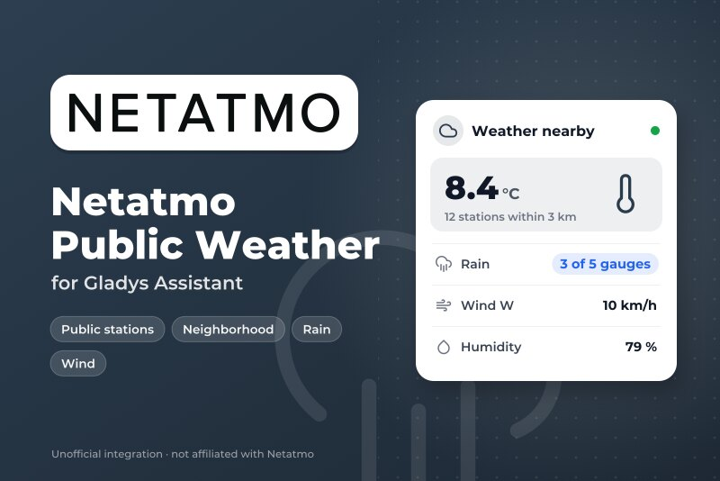
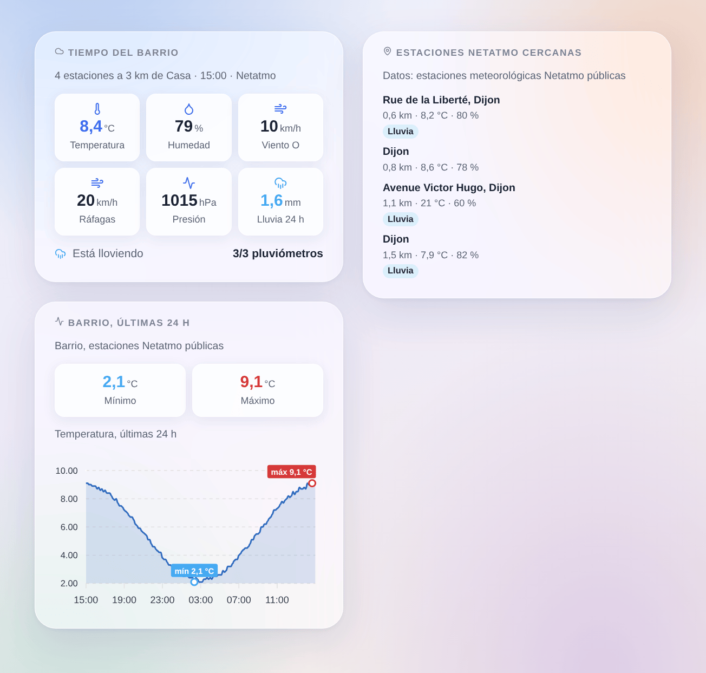
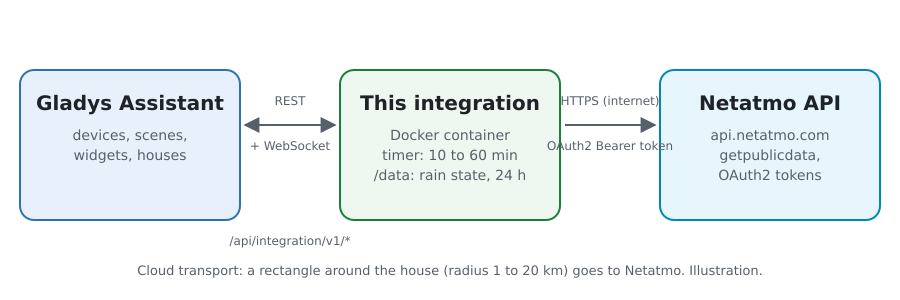
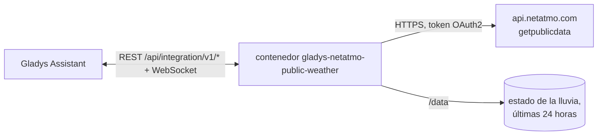
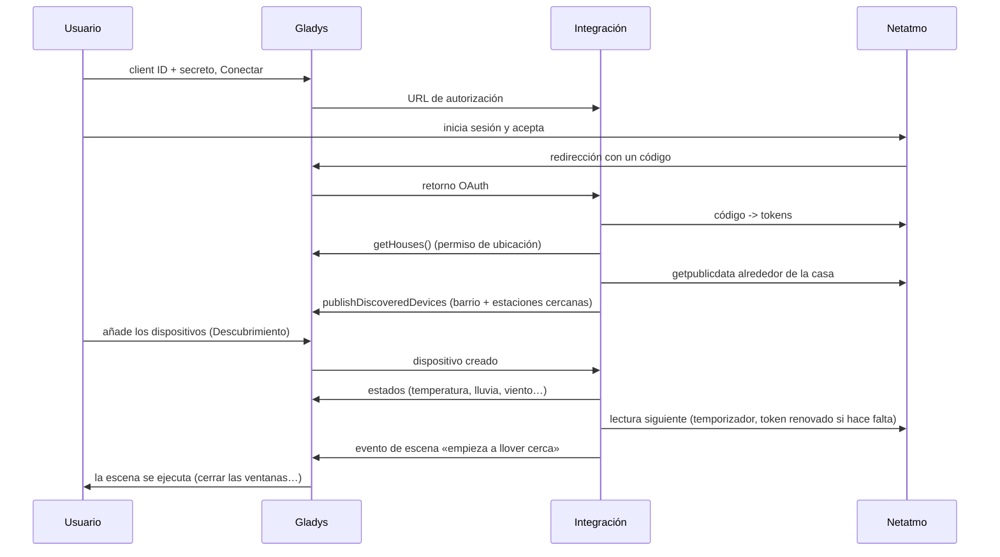

# Gladys Netatmo Public Weather

[English](README.md) · [Français](README.fr.md) · [Deutsch](README.de.md) · **Español**

[](LICENSE)
[](https://github.com/William-De71/gladys-netatmo-public-weather/releases)
[](https://github.com/William-De71/gladys-netatmo-public-weather/actions/workflows/release.yml)
[](https://gladysassistant.com)



Integración externa de [Gladys Assistant](https://gladysassistant.com) para las **estaciones meteorológicas Netatmo públicas**: miles de propietarios comparten su estación, y Gladys convierte las que rodean su casa en el tiempo de su barrio (lluvia, viento, temperatura), con escenas cuando la lluvia empieza o para. No hace falta ningún dispositivo Netatmo: basta una cuenta Netatmo gratuita y su propia aplicación Netatmo Connect.

## Funciones

- **El tiempo del barrio** (un dispositivo): temperatura, humedad, presión, lluvia de la última hora y en 24 horas, viento, ráfaga y dirección, lluvia sí/no y número de estaciones usadas. Mediana de las estaciones dentro del radio (1 a 20 km), o su media.
- **Las estaciones más cercanas** (hasta 20 dispositivos): las medidas de sus módulos (exterior, pluviómetro, anemómetro) y su distancia de la casa.
- **Disparadores de escena**: empieza a llover cerca, deja de llover cerca.
- **Acción de escena**: leer ahora el tiempo del barrio, con el radio que elija (salidas para notificaciones y condiciones).
- **Widgets**: tiempo del barrio, estaciones cercanas, el barrio en las últimas 24 horas (temperatura, humedad, presión, viento o lluvia).
- Español, inglés, francés y alemán.



## Funcionamiento







### Transporte

`transports: ["cloud"]`: todo pasa por `api.netatmo.com` en HTTPS. Netatmo recibe un rectángulo alrededor de la casa (el círculo del radio) y su token de acceso; los tokens se guardan en la configuración de Gladys, nunca en `/data` ni en los registros. `/data` guarda si llovía en la última lectura y el barrio de las últimas 26 horas.

## Dispositivos y funciones

| Dispositivo                          | Funciones                                                                                                                                           |
| ------------------------------------ | --------------------------------------------------------------------------------------------------------------------------------------------------- |
| Tiempo Netatmo alrededor de _casa_   | temperatura (°C), humedad (%), presión (hPa), lluvia 1 h (mm/h), lluvia 24 h (mm), viento y ráfaga (km/h), dirección (°), llueve, estaciones usadas |
| Netatmo _calle, ciudad_ (estaciones) | las medidas de los módulos de la estación, llueve (pluviómetro), distancia de la casa (km)                                                          |

Solo lectura. Un valor que Netatmo no da (ningún anemómetro cerca, una estación desconectada desde hace más de una hora) no se publica. «Llueve» es sí cuando al menos un tercio de los pluviómetros del radio (uno como mínimo) midieron lluvia en los últimos minutos o en la última hora.

## Disparadores, acciones de escena y widgets

- **Netatmo: empieza a llover cerca**, **Netatmo: deja de llover cerca** (tras dos lecturas secas seguidas). Variables: casa, pluviómetros que miden lluvia, pluviómetros cercanos, lluvia en 1 h y 24 h, temperatura, resumen, dispositivo.
- **Netatmo: leer el tiempo del barrio** (acción): radio (opcional) → estaciones, temperatura, humedad, presión, lluvia 1 h y 24 h, viento, ráfagas, dirección, llueve, resumen.
- Widgets: **Tiempo del barrio**, **Estaciones Netatmo cercanas**, **Barrio, últimas 24 h** (ajuste: la medida).

Ejemplos:

- Cuando empieza a llover cerca → cerrar la ventana del tejado y enviar «{{triggerEvent.data.summary}}».
- Cuando deja de llover cerca → reanudar el programa de riego del jardín.
- Cada noche a las 22:00 → leer el tiempo del barrio; si la temperatura baja de 1 °C → avisar «helada esta noche».

## Requisitos

- Gladys Assistant 5.3.0 o posterior (las instancias más antiguas no pueden instalar la integración).
- Una casa con posición en Gladys (Ajustes → Casas).
- Una cuenta Netatmo gratuita y una aplicación Netatmo Connect (dev.netatmo.com, 2 minutos). No hace falta ningún dispositivo Netatmo.

## Instalación

- **Desde la tienda**: Integraciones → Netatmo Public Weather → Instalar.
- **Desde la URL del repositorio**: Integraciones → Añadir una integración → `https://github.com/William-De71/gladys-netatmo-public-weather`.
- **Modo desarrollador**: ejecutar `npm start` con las variables que da Gladys (ver Desarrollo).

## Configuración

| Campo                                           | Descripción                                                                    |
| ----------------------------------------------- | ------------------------------------------------------------------------------ |
| ID de cliente / Secreto de cliente              | de su aplicación Netatmo Connect (dev.netatmo.com → Crear una aplicación)      |
| Cuenta Netatmo                                  | el botón Conectar: inicie sesión en Netatmo y acepte (read_station)            |
| Casa                                            | el centro; vacío: la primera casa con posición                                 |
| Radio (km)                                      | 1 a 20 (3 por defecto)                                                         |
| Combinar las estaciones por                     | mediana (recomendado) o media                                                  |
| Estaciones cercanas ofrecidas como dispositivos | 0, 5, 10 o 20                                                                  |
| Lectura cada                                    | 10 min (recomendado), 15, 30 o 60 min — una solicitud por lectura              |
| Idioma de los textos                            | nombres de los dispositivos y textos de las escenas; automático sigue el panel |

## Uso

1. Cree la aplicación Netatmo Connect, pegue su ID y su secreto, guarde, haga clic en **Conectar** y acepte.
2. Descubrimiento: añada «Tiempo Netatmo alrededor de …» y las estaciones que quiera.
3. Añada los widgets a un panel; cree escenas con los disparadores y la acción.

## Desarrollo

```bash
npm install
npm test                       # node --test, una API Netatmo falsa, nunca la red
npm run lint                   # ESLint
npm run format:check           # Prettier
npx github:GladysAssistant/integration-store . --skip-image-check
scripts/build-cover.sh         # cover.jpg desde docs/assets/cover.svg
docs/illustrations/render.sh   # docs/assets/widgets.<lang>.png
```

En local, el SDK lee `GLADYS_HOST_API_URL`, `GLADYS_INTEGRATION_TOKEN` y `GLADYS_INTEGRATION_SELECTOR` (dados por Gladys en modo desarrollador), y la integración lee `TZ`. `DEBUG=gladys-integration-sdk` muestra los registros del SDK.

Las pruebas cubren la lectura de `getpublicdata` (rectángulo, círculo, medidas caducadas, límites), el barrio (mediana, media, dirección del viento, lluvia), los eventos (referencia, pausa, reinicio), los tokens (renovación antes de caducar, rotación, token caducado, token de renovación rechazado), el flujo OAuth2, los dispositivos (controles de Gladys), los widgets (`validateWidgetContent`), el manifiesto, los cuatro idiomas, el script de release y la integración completa frente al Gladys falso del SDK. `test/structure.test.js` congela los identificadores externos y todas las claves que guardan los usuarios.

## Proceso de release


Cada fusión en `main` lanza la CI y luego calcula la versión a partir de los [Conventional Commits](https://www.conventionalcommits.org/) desde la última etiqueta: `feat` → menor, `fix` / `perf` → parche, `!` o `BREAKING CHANGE` → mayor (una menor antes de 1.0.0); `docs`, `chore`, `ci`, `test`, `style`, `refactor`, `build` solos no publican nada. Se genera la sección del changelog, se sube la etiqueta, se construye la imagen multiarquitectura, después `main` recibe el commit de release, se crea la GitHub Release y un último job comprueba la imagen pública, el validador de la tienda y el topic.

- El título del pull request se convierte en el commit squash y luego en la línea del changelog: escríbalo en inglés, para el usuario (`pr-title.yml` lo comprueba). Nunca edite `CHANGELOG.md` a mano.
- 1.0.0 es una decisión: Actions → Release → Run workflow con `release-as: 1.0.0`. `dry-run` muestra la versión y las notas sin publicar nada.
- **Rama protegida**: la release sube su commit a `main` con `GITHUB_TOKEN`. El ruleset `protect-main` (ni borrado ni force-push) lo deja pasar; una regla más estricta (pull request obligatorio, status checks) necesitaría GitHub Actions en su lista de excepciones, o una GitHub App.

## Solución de problemas

Vea [docs/es.md](docs/es.md#solución-de-problemas). Informe de los problemas con las versiones de Gladys y de la integración, el radio y el mensaje de **Leer Netatmo ahora**. Nunca pegue su secreto de cliente.

## Contribuir

Issues y pull requests bienvenidos. Ejecute `npm run format:check && npm run lint && npm test` antes de abrir un pull request y mantenga sin cambios los identificadores externos y las claves guardadas (ver [CLAUDE.md](CLAUDE.md)).

## Seguridad

Vea [SECURITY.md](SECURITY.md): informe de las vulnerabilidades en privado. El secreto de cliente es un campo `secret` y los tokens viven en claves de configuración internas: nunca registrados, nunca escritos en `/data`, enviados solo a `api.netatmo.com`.

## Capturas por venir

Las imágenes de arriba son ilustraciones, no capturas de pantalla. Las capturas reales irán en `docs/assets/screenshots/` (PNG, 1280 × 800): `configuration.png` (la configuración conectada), `discovery.png` (el barrio y las estaciones ofrecidos), `device.png` (el dispositivo del barrio), `scene-rain.png` (una escena con el disparador de lluvia).

## Licencia

[Licencia Apache 2.0](LICENSE) — vea también [NOTICE](NOTICE). Datos meteorológicos: las estaciones meteorológicas Netatmo públicas, a través de la API Netatmo Connect. Este proyecto no está afiliado a Netatmo ni a Legrand, ni respaldado o patrocinado por ellos. Gracias a la documentación y al SDK de Gladys, y a los propietarios de Netatmo que comparten su estación.
