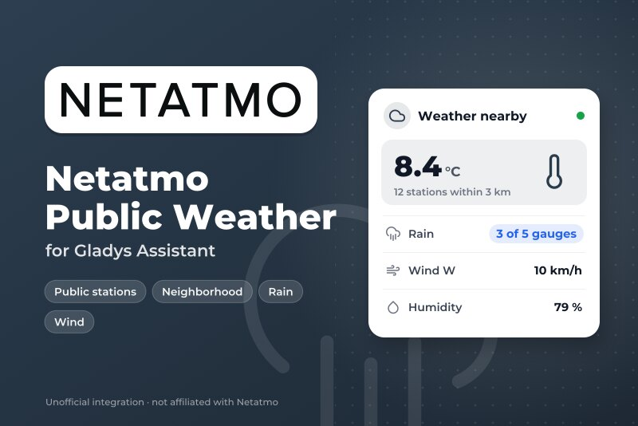
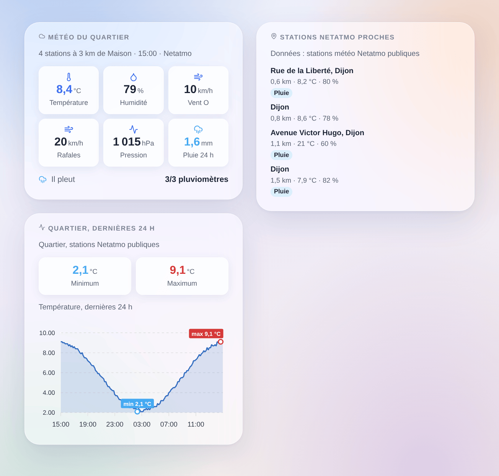
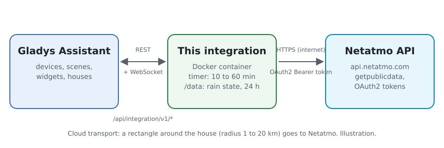
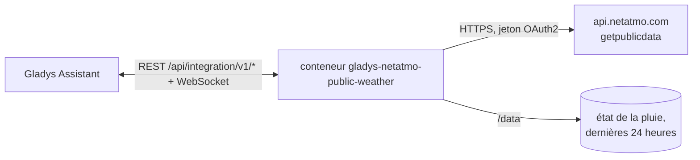
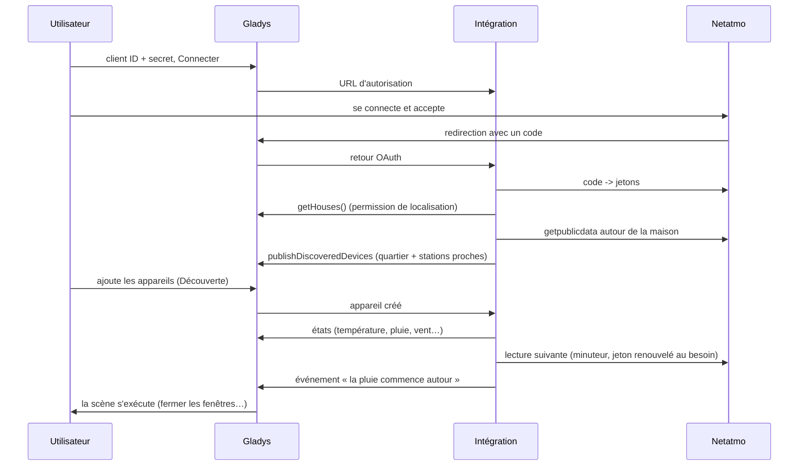

# Gladys Netatmo Public Weather

[English](README.md) · **Français** · [Deutsch](README.de.md) · [Español](README.es.md)

[](LICENSE)
[](https://github.com/William-De71/gladys-netatmo-public-weather/releases)
[](https://github.com/William-De71/gladys-netatmo-public-weather/actions/workflows/release.yml)
[](https://gladysassistant.com)



Intégration externe [Gladys Assistant](https://gladysassistant.com) pour les **stations météo Netatmo publiques** : des milliers de propriétaires partagent leur station, et Gladys transforme celles autour de chez vous en météo de votre quartier (pluie, vent, température), avec des scènes quand la pluie commence ou s’arrête. Aucun appareil Netatmo nécessaire : un compte Netatmo gratuit et votre propre application Netatmo Connect suffisent.

## Fonctionnalités

- **La météo du quartier** (un appareil) : température, humidité, pression, pluie de la dernière heure et sur 24 heures, vent, rafale et direction, pluie oui/non et nombre de stations utilisées. Médiane des stations dans le rayon (1 à 20 km), ou leur moyenne.
- **Les stations les plus proches** (jusqu’à 20 appareils) : les mesures de leurs modules (extérieur, pluviomètre, anémomètre) et leur distance de la maison.
- **Déclencheurs de scène** : la pluie commence autour, la pluie s’arrête autour.
- **Action de scène** : lire maintenant la météo du quartier, avec le rayon de votre choix (sorties pour les notifications et les conditions).
- **Widgets** : météo du quartier, stations proches, le quartier sur les dernières 24 heures (température, humidité, pression, vent ou pluie).
- Français, anglais, allemand et espagnol.



## Fonctionnement







### Transport

`transports: ["cloud"]` : tout passe par `api.netatmo.com` en HTTPS. Netatmo reçoit un rectangle autour de la maison (le cercle du rayon) et votre jeton d’accès ; les jetons sont gardés dans la configuration de Gladys, jamais dans `/data` ni dans les journaux. `/data` garde s’il pleuvait à la dernière lecture et le quartier sur les 26 dernières heures.

## Appareils et fonctionnalités

| Appareil                         | Fonctionnalités                                                                                                                                       |
| -------------------------------- | ----------------------------------------------------------------------------------------------------------------------------------------------------- |
| Météo Netatmo autour de _maison_ | température (°C), humidité (%), pression (hPa), pluie 1 h (mm/h), pluie 24 h (mm), vent et rafale (km/h), direction (°), il pleut, stations utilisées |
| Netatmo _rue, ville_ (stations)  | les mesures des modules de la station, il pleut (pluviomètre), distance de la maison (km)                                                             |

Lecture seule. Une valeur que Netatmo ne donne pas (pas d’anémomètre autour, station hors ligne depuis plus d’une heure) n’est pas publiée. « Il pleut » vaut oui quand au moins un tiers des pluviomètres du rayon (un au minimum) ont mesuré de la pluie ces dernières minutes ou sur la dernière heure.

## Déclencheurs, actions de scène et widgets

- **Netatmo : la pluie commence autour**, **Netatmo : la pluie s’arrête autour** (après deux lectures sèches de suite). Variables : maison, pluviomètres qui mesurent de la pluie, pluviomètres à proximité, pluie sur 1 h et 24 h, température, résumé, appareil.
- **Netatmo : lire la météo du quartier** (action) : rayon (facultatif) → stations, température, humidité, pression, pluie 1 h et 24 h, vent, rafales, direction, il pleut, résumé.
- Widgets : **Météo du quartier**, **Stations Netatmo proches**, **Quartier, dernières 24 h** (réglage : la mesure).

Exemples :

- Quand la pluie commence autour → fermer le Velux et envoyer « {{triggerEvent.data.summary}} ».
- Quand la pluie s’arrête autour → reprendre le programme d’arrosage du jardin.
- Chaque soir à 22 h → lire la météo du quartier ; si la température est sous 1 °C → notifier « gel cette nuit ».

## Prérequis

- Gladys Assistant 5.3.0 ou plus récent (les instances plus anciennes ne peuvent pas installer l’intégration).
- Une maison avec une position dans Gladys (Paramètres → Maisons).
- Un compte Netatmo gratuit et une application Netatmo Connect (dev.netatmo.com, 2 minutes). Aucun appareil Netatmo nécessaire.

## Installation

- **Depuis le store** : Intégrations → Netatmo Public Weather → Installer.
- **Depuis l’URL du dépôt** : Intégrations → Ajouter une intégration → `https://github.com/William-De71/gladys-netatmo-public-weather`.
- **Mode développeur** : lancer `npm start` avec les variables fournies par Gladys (voir Développement).

## Configuration

| Champ                                      | Description                                                                    |
| ------------------------------------------ | ------------------------------------------------------------------------------ |
| Identifiant client / Secret client         | de votre application Netatmo Connect (dev.netatmo.com → Créer une application) |
| Compte Netatmo                             | le bouton Connecter : connectez-vous chez Netatmo et acceptez (read_station)   |
| Maison                                     | le centre ; vide : la première maison qui a une position                       |
| Rayon (km)                                 | 1 à 20 (3 par défaut)                                                          |
| Combiner les stations par                  | médiane (recommandé) ou moyenne                                                |
| Stations proches proposées comme appareils | 0, 5, 10 ou 20                                                                 |
| Lecture toutes les                         | 10 min (recommandé), 15, 30 ou 60 min — une requête par lecture                |
| Langue des textes                          | noms des appareils et textes des scènes ; automatique suit le tableau de bord  |

## Utilisation

1. Créez l’application Netatmo Connect, collez son identifiant et son secret, enregistrez, cliquez sur **Connecter** et acceptez.
2. Découverte : ajoutez « Météo Netatmo autour de … » et les stations voulues.
3. Ajoutez les widgets à un tableau de bord ; créez des scènes avec les déclencheurs et l’action.

## Développement

```bash
npm install
npm test                       # node --test, une fausse API Netatmo, jamais le réseau
npm run lint                   # ESLint
npm run format:check           # Prettier
npx github:GladysAssistant/integration-store . --skip-image-check
scripts/build-cover.sh         # cover.jpg depuis docs/assets/cover.svg
docs/illustrations/render.sh   # docs/assets/widgets.<lang>.png
```

En local, le SDK lit `GLADYS_HOST_API_URL`, `GLADYS_INTEGRATION_TOKEN` et `GLADYS_INTEGRATION_SELECTOR` (donnés par Gladys en mode développeur), et l’intégration lit `TZ`. `DEBUG=gladys-integration-sdk` affiche les journaux du SDK.

Les tests couvrent la lecture de `getpublicdata` (rectangle, cercle, mesures périmées, bornes), le quartier (médiane, moyenne, direction du vent, pluie), les événements (référence, pause, redémarrage), les jetons (renouvellement avant expiration, rotation, jeton expiré, jeton de renouvellement refusé), le flux OAuth2, les appareils (contrôles de Gladys), les widgets (`validateWidgetContent`), le manifeste, les quatre langues, le script de release et l’intégration complète face au faux Gladys du SDK. `test/structure.test.js` fige les identifiants externes et toutes les clés que les utilisateurs enregistrent.

## Processus de release


Chaque fusion sur `main` lance la CI, puis calcule la version à partir des [Conventional Commits](https://www.conventionalcommits.org/) depuis le dernier tag : `feat` → mineure, `fix` / `perf` → correctif, `!` ou `BREAKING CHANGE` → majeure (une mineure avant 1.0.0) ; `docs`, `chore`, `ci`, `test`, `style`, `refactor`, `build` seuls ne publient rien. La section du changelog est générée, le tag poussé, l’image multi-architecture construite, puis `main` reçoit le commit de release, la GitHub Release est créée et un dernier job vérifie l’image publique, le validateur du store et le topic.

- Le titre de la pull request devient le commit squash, puis la ligne du changelog : écrivez-le en anglais, pour l’utilisateur (`pr-title.yml` le vérifie). Ne modifiez jamais `CHANGELOG.md` à la main.
- 1.0.0 est une décision : Actions → Release → Run workflow avec `release-as: 1.0.0`. `dry-run` montre la version et les notes sans rien publier.
- **Branche protégée** : la release pousse son commit sur `main` avec `GITHUB_TOKEN`. Le ruleset `protect-main` (ni suppression, ni force-push) le laisse passer ; une règle plus stricte (pull request obligatoire, status checks) demanderait GitHub Actions dans sa liste de contournement, ou une GitHub App.

## Dépannage

Voir [docs/fr.md](docs/fr.md#dépannage). Signalez les problèmes avec les versions de Gladys et de l’intégration, le rayon et le message de **Lire Netatmo maintenant**. Ne collez jamais votre secret client.

## Contribuer

Issues et pull requests bienvenues. Lancez `npm run format:check && npm run lint && npm test` avant d’ouvrir une pull request, et gardez inchangés les identifiants externes et les clés enregistrées (voir [CLAUDE.md](CLAUDE.md)).

## Sécurité

Voir [SECURITY.md](SECURITY.md) : signalez les failles en privé. Le secret client est un champ `secret` et les jetons vivent dans des clés de configuration internes : jamais journalisés, jamais écrits dans `/data`, envoyés seulement à `api.netatmo.com`.

## Captures à venir

Les images ci-dessus sont des illustrations, pas des captures d’écran. Les vraies captures iront dans `docs/assets/screenshots/` (PNG, 1280 × 800) : `configuration.png` (la configuration connectée), `discovery.png` (le quartier et les stations proposés), `device.png` (l’appareil du quartier), `scene-rain.png` (une scène sur le déclencheur de pluie).

## Licence

[Licence Apache 2.0](LICENSE) — voir aussi [NOTICE](NOTICE). Données météo : les stations météo Netatmo publiques, via l’API Netatmo Connect. Ce projet n’est ni affilié à Netatmo ou Legrand, ni approuvé ou soutenu par eux. Merci à la documentation et au SDK de Gladys, et aux propriétaires Netatmo qui partagent leur station.
