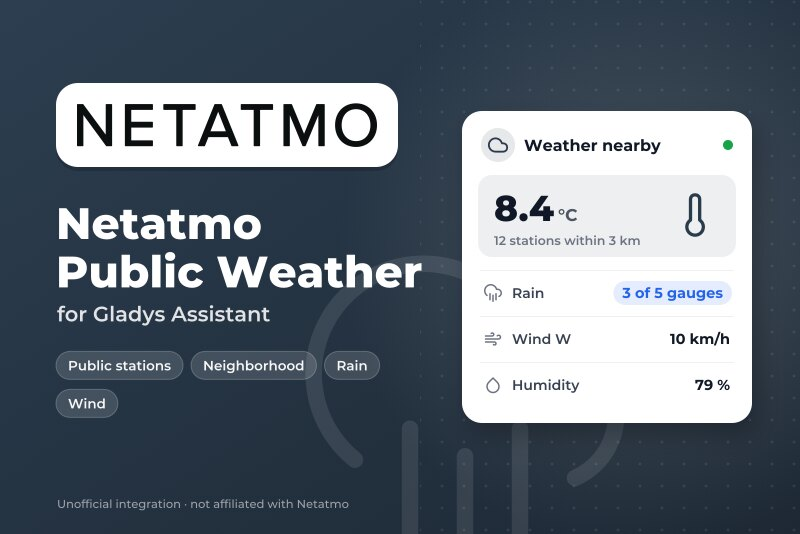
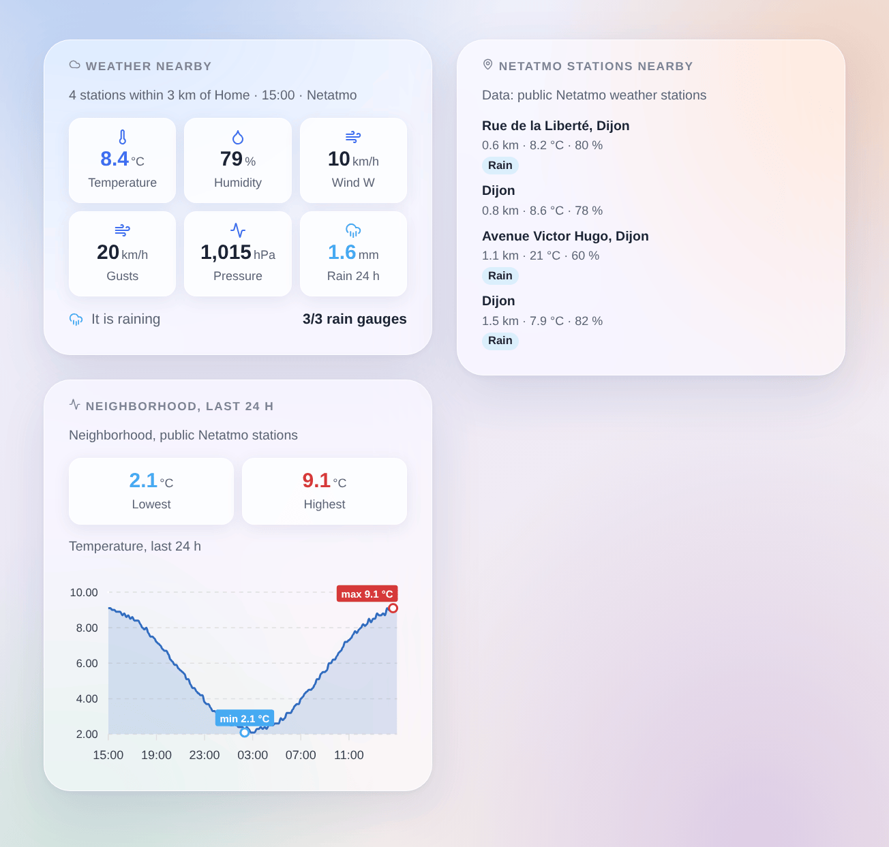
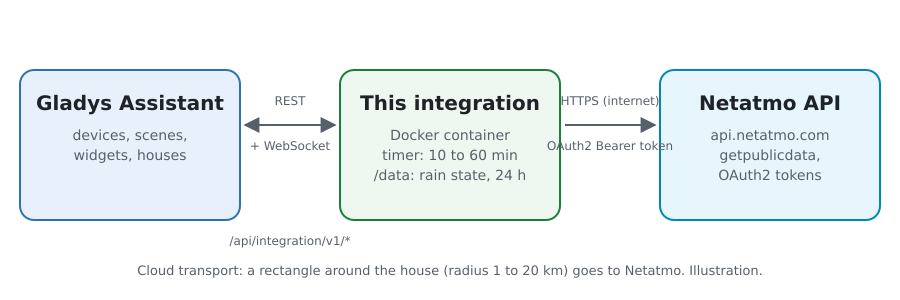
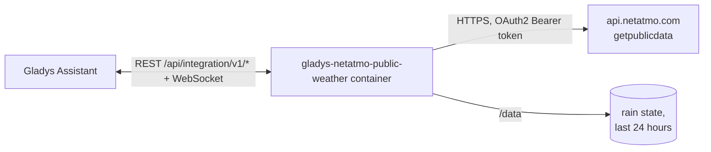
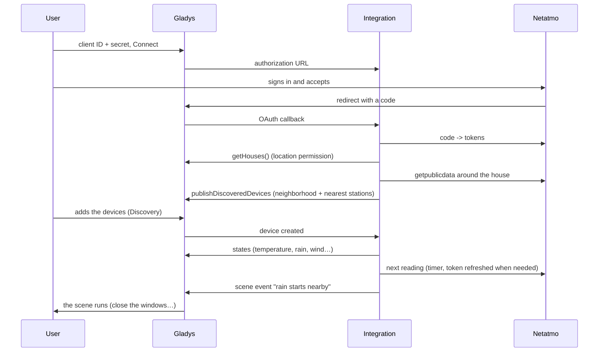

# Gladys Netatmo Public Weather

**English** · [Français](README.fr.md) · [Deutsch](README.de.md) · [Español](README.es.md)

[](LICENSE)
[](https://github.com/William-De71/gladys-netatmo-public-weather/releases)
[](https://github.com/William-De71/gladys-netatmo-public-weather/actions/workflows/release.yml)
[](https://gladysassistant.com)



[Gladys Assistant](https://gladysassistant.com) external integration for the **public Netatmo weather stations**: thousands of owners share their station, and Gladys turns those around your home into the weather of your neighborhood (rain, wind, temperature), with scenes when the rain starts or stops. No Netatmo device needed: a free Netatmo account and your own Netatmo Connect application are enough.

## Features

- **The weather of the neighborhood** (a device): temperature, humidity, pressure, rain over the last hour and over 24 hours, wind, gust and direction, raining yes/no and the number of stations used. Median of the stations within the radius (1 to 20 km), or their mean.
- **The nearest stations** (up to 20 devices): the measures of their modules (outdoor, rain gauge, anemometer) and their distance from home.
- **Scene triggers**: the rain starts nearby, the rain stops nearby.
- **Scene action**: read the weather nearby now, with the radius of your choice (outputs for notifications and conditions).
- **Dashboard widgets**: weather nearby, nearest stations, the neighborhood over the last 24 hours (temperature, humidity, pressure, wind or rain).
- English, French, German and Spanish.



## How it works







### Transport

`transports: ["cloud"]`: everything goes to `api.netatmo.com` over HTTPS. Netatmo receives a rectangle around the house (the circle of the radius) and your access token; the tokens are kept in the configuration of Gladys, never in `/data` nor in the logs. `/data` keeps whether it rained at the last reading and the neighborhood over the last 26 hours.

## Devices and features

| Device                            | Features                                                                                                                                     |
| --------------------------------- | -------------------------------------------------------------------------------------------------------------------------------------------- |
| Netatmo weather around _house_    | temperature (°C), humidity (%), pressure (hPa), rain 1 h (mm/h), rain 24 h (mm), wind and gust (km/h), direction (°), raining, stations used |
| Netatmo _street, town_ (stations) | the measures of the station's modules, raining (rain gauge), distance from home (km)                                                         |

Read only. A value Netatmo does not give (no anemometer nearby, a station offline for more than an hour) is not published. "Raining" is yes when at least a third of the rain gauges in the radius (one at least) measured rain over the last minutes or the last hour.

## Scene triggers, actions and widgets

- **Netatmo: rain starts nearby**, **Netatmo: rain stops nearby** (after two dry readings in a row). Variables: house, rain gauges measuring rain, rain gauges nearby, rain over 1 h and 24 h, temperature, summary, device.
- **Netatmo: read the weather nearby** (action): radius (optional) → stations, temperature, humidity, pressure, rain 1 h and 24 h, wind, gust, direction, raining, summary.
- Widgets: **Weather nearby**, **Netatmo stations nearby**, **Neighborhood, last 24 h** (setting: the measure).

Examples:

- When the rain starts nearby → close the roof window and send "{{triggerEvent.data.summary}}".
- When the rain stops nearby → resume the garden watering schedule.
- Every evening at 22:00 → read the weather nearby; if the temperature is below 1 °C → notify "frost tonight".

## Requirements

- Gladys Assistant 5.3.0 or later (older instances cannot install the integration).
- A house with a position in Gladys (Settings → Houses).
- A free Netatmo account and a Netatmo Connect application (dev.netatmo.com, 2 minutes). No Netatmo device needed.

## Installation

- **From the store**: Integrations → Netatmo Public Weather → Install.
- **From the repository URL**: Integrations → Add an integration → `https://github.com/William-De71/gladys-netatmo-public-weather`.
- **Developer mode**: run `npm start` with the variables Gladys gives (see Development).

## Configuration

| Field                              | Description                                                                   |
| ---------------------------------- | ----------------------------------------------------------------------------- |
| Client ID / Client secret          | of your Netatmo Connect application (dev.netatmo.com → Create an application) |
| Netatmo account                    | the Connect button: sign in at Netatmo and accept (read_station)              |
| House                              | the center; empty: the first house with a position                            |
| Radius (km)                        | 1 to 20 (default 3)                                                           |
| Combine the stations by            | median (recommended) or mean                                                  |
| Nearby stations offered as devices | 0, 5, 10 or 20                                                                |
| Reading every                      | 10 min (recommended), 15, 30 or 60 min — one request per reading              |
| Language of the texts              | device names and scene texts; automatic follows the dashboard                 |

## Usage

1. Create the Netatmo Connect application, paste its client ID and secret, save, click **Connect** and accept.
2. Discovery: add "Netatmo weather around …" and the stations you want.
3. Add the widgets to a dashboard; create scenes with the triggers and the action.

## Development

```bash
npm install
npm test                       # node --test, a fake Netatmo API, never the network
npm run lint                   # ESLint
npm run format:check           # Prettier
npx github:GladysAssistant/integration-store . --skip-image-check
scripts/build-cover.sh         # cover.jpg from docs/assets/cover.svg
docs/illustrations/render.sh   # docs/assets/widgets.<lang>.png
```

Locally, the SDK reads `GLADYS_HOST_API_URL`, `GLADYS_INTEGRATION_TOKEN` and `GLADYS_INTEGRATION_SELECTOR` (given by Gladys in developer mode), and the integration reads `TZ`. `DEBUG=gladys-integration-sdk` shows the SDK logs.

The tests cover the reading of `getpublicdata` (rectangle, circle, stale measures, bounds), the neighborhood (median, mean, wind direction, rain), the events (baseline, pause, restart), the tokens (refresh before expiry, rotation, expired token, refused refresh token), the OAuth2 flow, the devices (Gladys checks), the widgets (`validateWidgetContent`), the manifest, the four languages, the release script and the whole integration against the fake Gladys of the SDK. `test/structure.test.js` freezes the external ids and every key users store.

## Release process


Every merge on `main` runs the CI, then computes the version from the [Conventional Commits](https://www.conventionalcommits.org/) since the last tag: `feat` → minor, `fix` / `perf` → patch, `!` or `BREAKING CHANGE` → major (a minor below 1.0.0); `docs`, `chore`, `ci`, `test`, `style`, `refactor`, `build` alone publish nothing. The changelog section is generated, the tag pushed, the multi-architecture image built, then `main` receives the release commit, the GitHub Release is created and a last job checks the public image, the store validator and the topic.

- The pull request title becomes the squash commit, then the changelog line: write it in English, for the user (`pr-title.yml` checks it). Never edit `CHANGELOG.md` by hand.
- 1.0.0 is a decision: Actions → Release → Run workflow with `release-as: 1.0.0`. `dry-run` shows the version and the notes without publishing.
- **Protected branch**: rulesets require a pull request on `main` and lock the `v*` tags; only the maintainer and deploy keys get through. The release pushes with the deploy key of the `release` environment (secret `RELEASE_DEPLOY_KEY`, `main` only): a run from another branch never gets it. `build.yml` and `github-release.yml` do not start on a tag: the release calls them, or run them by hand (Actions → Run workflow, with `version` for the image) to finish a release.

## Troubleshooting

See [docs/en.md](docs/en.md#troubleshooting). Report issues with the versions of Gladys and of the integration, the radius and the message of **Read Netatmo now**. Never paste your client secret.

## Contributing

Issues and pull requests are welcome. Run `npm run format:check && npm run lint && npm test` before opening a pull request, and keep every external id and stored key unchanged (see [CLAUDE.md](CLAUDE.md)).

## Security

See [SECURITY.md](SECURITY.md): report vulnerabilities privately. The client secret is a `secret` field and the tokens live in internal configuration keys: never logged, never written to `/data`, sent only to `api.netatmo.com`.

## Screenshots to come

The images above are illustrations, not screenshots. Real screenshots will go in `docs/assets/screenshots/` (PNG, 1280 × 800): `configuration.png` (the configuration connected), `discovery.png` (the neighborhood and the stations offered), `device.png` (the neighborhood device), `scene-rain.png` (a scene on the rain trigger).

## License

[Apache License 2.0](LICENSE) — see also [NOTICE](NOTICE). Weather data: the public Netatmo weather stations, through the Netatmo Connect API. This project is not affiliated with, endorsed or sponsored by Netatmo or Legrand. Thanks to the Gladys documentation and SDK, and to the Netatmo owners who share their station.
