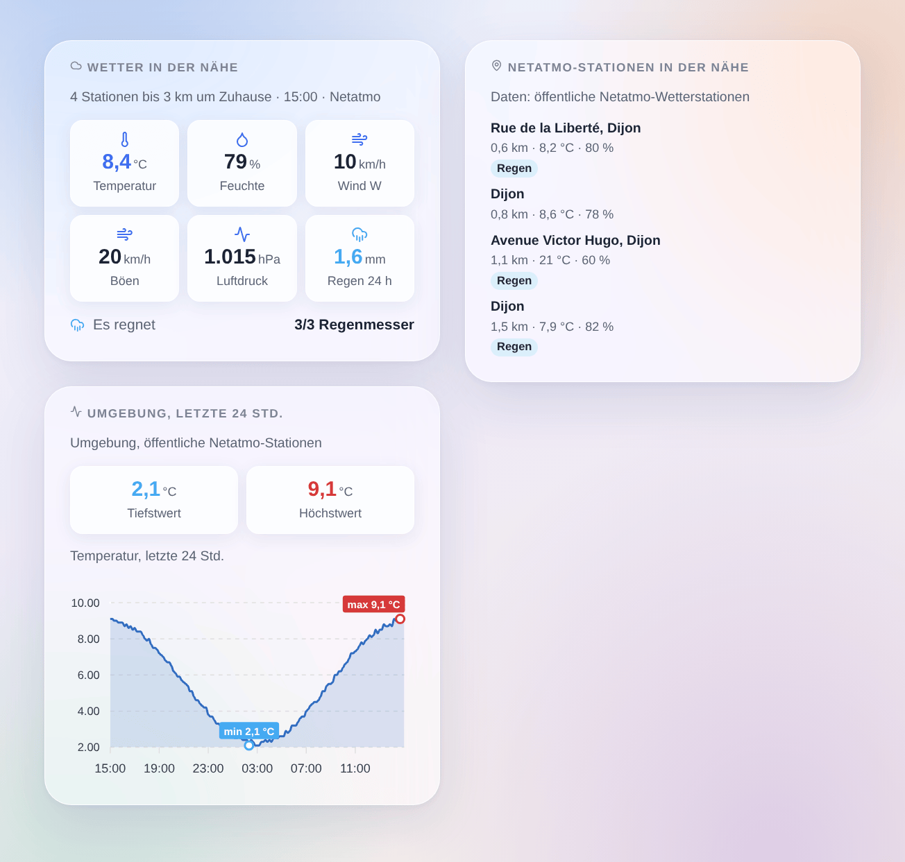

# Netatmo Public Weather

## Überblick

Tausende Netatmo-Besitzer teilen die Messwerte ihrer Wetterstation. Diese Integration liest die öffentlichen Stationen rund um ein Zuhause in Gladys und macht daraus das Wetter deiner Umgebung: Temperatur, Luftfeuchtigkeit, Luftdruck, Regen, Wind. Sie sagt deinen Szenen, wenn der Regen in der Nähe beginnt oder aufhört, und zeigt die nächsten Stationen im Dashboard. Du brauchst kein Netatmo-Gerät.

## Voraussetzungen

- Gladys Assistant 5.3.0 oder neuer.
- Ein Zuhause mit Position in Gladys (Einstellungen → Häuser).
- Ein kostenloses Netatmo-Konto und deine eigene Netatmo-Connect-Anwendung.

### Eine Netatmo-Anwendung erstellen

1. Öffne https://dev.netatmo.com/apps/createanapp#form und melde dich mit einem Netatmo-Konto an (lege bei Bedarf eines an).
2. Fülle die Pflichtfelder aus: Name (z. B. „Gladys“), Beschreibung, dein Name und deine E-Mail. Lass „Redirect URI“ und „Webhook URI“ leer.
3. Speichern: die Seite zeigt eine „client ID“ und ein „client secret“.

Nutzt du schon die Netatmo-Integration von Gladys, lege für diese hier eine zweite Anwendung an: jede Integration behält ihre eigenen Tokens.

## Konfiguration

1. Integrationen → Netatmo Public Weather → Konfiguration: füge Client-ID und Client-Secret ein und klicke auf **Konfiguration speichern**.
2. Klicke neben „Netatmo-Konto“ auf **Verbinden**, melde dich bei Netatmo an und bestätige (Gladys fragt nur Lesezugriff auf Wetterdaten an). Der Status wechselt auf verbunden. Lehnt Netatmo die Weiterleitungsadresse ab, füge die von Gladys angezeigte unter „Redirect URI“ deiner Anwendung ein.
3. Wähle das Zuhause, den Radius (1 bis 20 km, Standard 3: in der Stadt reichen 2 bis 5 km, auf dem Land größer wählen), wie die Stationen zusammengefasst werden (der Median ignoriert eine schlecht aufgestellte Station), wie viele nahe Stationen als Geräte angeboten werden und das Abrufintervall (10 Minuten empfohlen: eine Anfrage pro Abruf).
4. Drücke **Netatmo jetzt abrufen** zur Kontrolle: das Wetter der Umgebung wird angezeigt.

## Nutzung

### Geräte

Füge in der Erkennung **Netatmo-Wetter um …** hinzu: Temperatur, Luftfeuchtigkeit, Luftdruck (Meereshöhe), Regen der letzten Stunde und in 24 Stunden, Wind, Böe, Richtung, „Es regnet“ (ja, wenn ein Drittel der Regenmesser in der Nähe Regen misst) und die Anzahl der genutzten Stationen. Füge die nahen Stationen hinzu, die du willst: jede liefert die Messwerte ihrer Module und ihre Entfernung vom Zuhause. Ein Wert, den Netatmo nicht liefert, wird nicht angezeigt.

### Dashboard-Widgets

- **Wetter in der Nähe**: Regen oder nicht, Temperatur, Feuchte, Wind, Böen, Luftdruck, Regen in 24 Stunden.
- **Netatmo-Stationen in der Nähe**: die nächsten Stationen mit Entfernung und Messwerten.
- **Umgebung, letzte 24 Std.**: ein Diagramm von Temperatur, Feuchte, Luftdruck, Wind oder Regen (Einstellung) mit Tiefst- und Höchstwert. Es füllt sich am ersten Tag.

### Szenen

- Auslöser **Netatmo: Regen beginnt in der Nähe** und **Netatmo: Regen hört in der Nähe auf** (nach zwei trockenen Abrufen in Folge, damit eine Pause zwischen zwei Schauern kein Ende ist). Ihre Variablen: Regen in 1 h und 24 h, Regenmesser, Temperatur, eine fertige Zusammenfassung.
- Aktion **Netatmo: Wetter in der Nähe abrufen**: liest die Stationen jetzt, mit dem Radius deiner Wahl, und gibt die Werte und eine Zusammenfassung an die nächsten Aktionen.

Beispiele: wenn der Regen in der Nähe beginnt, das Dachfenster schließen und die Zusammenfassung senden; wenn er aufhört, die Bewässerung fortsetzen; jeden Abend das Wetter abrufen und unter 1 °C vor Frost warnen.

### Transport

Cloud: die Integration ruft api.netatmo.com per HTTPS auf. Netatmo erhält ein Rechteck um dein Zuhause und dein Zugriffstoken. Die Tokens bleiben in der Konfiguration von Gladys; sie werden nie in die Logs geschrieben.

## Fehlerbehebung

- **„Gib Client-ID und Secret ein“**: speichere beide Felder, bevor du auf Verbinden klickst.
- **„Netatmo hat die Verbindung abgelehnt“**: prüfe Client-ID und Secret (eine Kopie mit Leerzeichen, eine gelöschte Anwendung) und klicke erneut auf Verbinden. Netatmo lehnt auch ab, wenn der Zugriff in deinem Netatmo-Konto widerrufen wurde.
- **„Kein Zuhause in Gladys hat eine Position“**: lege sie unter Einstellungen → Häuser fest.
- **Keine Station**: vergrößere den Radius. Stationen, die seit über einer Stunde offline sind, werden nicht genutzt.
- **„Netatmo begrenzt die Anfragen“**: Netatmo erlaubt 500 Anfragen pro Stunde und Konto; ein anderes Werkzeug mit demselben Konto kann sie aufbrauchen. Die Integration versucht es in 15 Minuten erneut.
- Um ein Problem zu melden, öffne ein Issue mit den Versionen von Gladys und der Integration, dem Radius und der Meldung von **Netatmo jetzt abrufen**. Füge nie dein Client-Secret ein.
