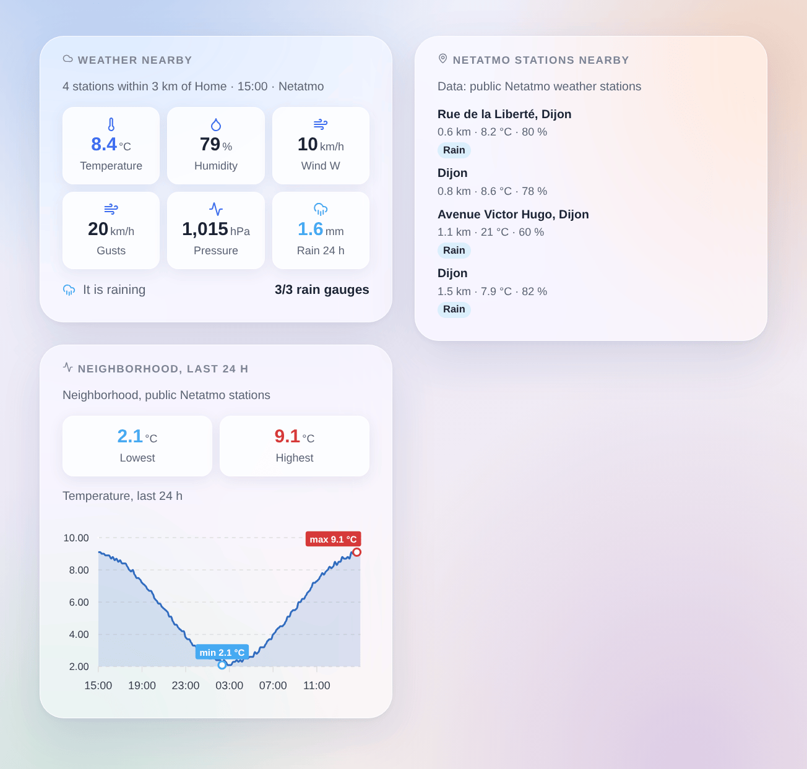

# Netatmo Public Weather

## Overview

Thousands of Netatmo owners share the measures of their weather station. This integration reads the public stations around a house of Gladys and turns them into the weather of your neighborhood: temperature, humidity, pressure, rain, wind. It tells your scenes when the rain starts or stops nearby, and shows the nearest stations on the dashboard. You do not need any Netatmo device.

## Prerequisites

- Gladys Assistant 5.3.0 or later.
- A house with a position in Gladys (Settings → Houses).
- A free Netatmo account and your own Netatmo Connect application.

### Create a Netatmo application

1. Open https://dev.netatmo.com/apps/createanapp#form and sign in with a Netatmo account (create one if needed).
2. Fill in the required fields: name (e.g. "Gladys"), description, your name and e-mail. Leave "Redirect URI" and "Webhook URI" empty.
3. Save: the page shows a "client ID" and a "client secret".

If you already use the Netatmo integration of Gladys, create a second application for this one: each integration keeps its own tokens.

## Configuration

1. Integrations → Netatmo Public Weather → Configuration: paste the client ID and the client secret, then click **Save configuration**.
2. Click **Connect** next to "Netatmo account", sign in at Netatmo and accept (Gladys only asks to read weather data). The status turns to connected. If Netatmo refuses the redirect address, paste the one Gladys shows into the "Redirect URI" of your application.
3. Choose the house, the radius (1 to 20 km, 3 by default: 2 to 5 km is enough in town, widen it in the countryside), how the stations are combined (the median ignores a badly placed station), how many nearby stations are offered as devices and the reading interval (10 minutes recommended: one request per reading).
4. Press **Read Netatmo now** to check: it shows the weather of the neighborhood.

## Usage

### Devices

In Discovery, add **Netatmo weather around …**: temperature, humidity, pressure (sea level), rain over the last hour and over 24 hours, wind, gust, direction, "Raining" (yes when a third of the rain gauges nearby measure rain) and the number of stations used. Add the nearest stations you want: each one gives the measures of its modules and its distance from home. A value Netatmo does not give is not shown.

### Dashboard widgets

- **Weather nearby**: raining or not, temperature, humidity, wind, gusts, pressure, rain over 24 hours.
- **Netatmo stations nearby**: the nearest stations with their distance and measures.
- **Neighborhood, last 24 h**: a chart of the temperature, humidity, pressure, wind or rain (setting), with its lowest and highest values. It fills up over the first day.

### Scenes

- Triggers **Netatmo: rain starts nearby** and **Netatmo: rain stops nearby** (after two dry readings in a row, so that a pause between two showers is not an end). Their variables: rain over 1 h and 24 h, rain gauges, temperature, a ready-made summary.
- Action **Netatmo: read the weather nearby**: reads the stations now, with the radius you choose, and gives the values and a summary to the next actions.

Examples: when the rain starts nearby, close the roof window and send the summary; when it stops, resume the watering; every evening, read the weather and warn of frost below 1 °C.

### Transport

Cloud: the integration calls api.netatmo.com over HTTPS. Netatmo receives a rectangle around your house and your access token. The tokens stay in the configuration of Gladys; they are never written to the logs.

## Troubleshooting

- **"Enter the client ID and secret"**: save both fields before clicking Connect.
- **"Netatmo refused the connection"**: check the client ID and secret (a copy with a space, an application deleted), then click Connect again. Netatmo also refuses when the access was revoked from your Netatmo account.
- **"No house of Gladys has a position"**: set it in Settings → Houses.
- **No station**: widen the radius. Stations offline for more than an hour are not used.
- **"Netatmo limits the requests"**: Netatmo allows 500 requests an hour per account; another tool using the same account may use them up. The integration tries again in 15 minutes.
- To report a problem, open an issue with the versions of Gladys and of the integration, the radius and the message of **Read Netatmo now**. Never paste your client secret.
