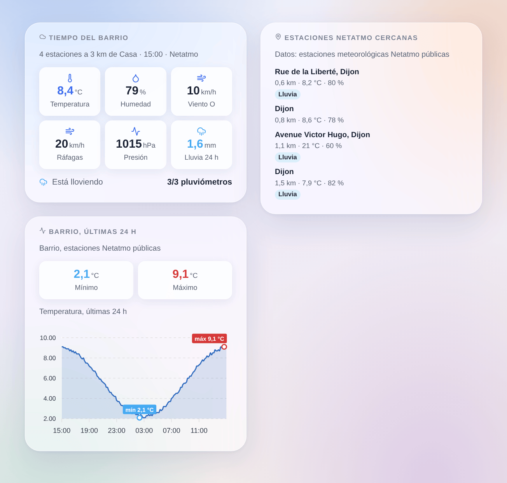

# Netatmo Public Weather

## Presentación

Miles de propietarios de Netatmo comparten las medidas de su estación meteorológica. Esta integración lee las estaciones públicas alrededor de una casa de Gladys y las convierte en el tiempo de su barrio: temperatura, humedad, presión, lluvia, viento. Avisa a sus escenas cuando empieza o deja de llover cerca y muestra las estaciones más cercanas en el panel. No necesita ningún dispositivo Netatmo.

## Requisitos

- Gladys Assistant 5.3.0 o posterior.
- Una casa con posición en Gladys (Ajustes → Casas).
- Una cuenta Netatmo gratuita y su propia aplicación Netatmo Connect.

### Crear una aplicación Netatmo

1. Abra https://dev.netatmo.com/apps/createanapp#form e inicie sesión con una cuenta Netatmo (cree una si hace falta).
2. Rellene los campos obligatorios: nombre (p. ej. «Gladys»), descripción, su nombre y correo. Deje vacíos «Redirect URI» y «Webhook URI».
3. Guarde: la página muestra un «client ID» y un «client secret».

Si ya usa la integración Netatmo de Gladys, cree una segunda aplicación para esta: cada integración guarda sus propios tokens.

## Configuración

1. Integraciones → Netatmo Public Weather → Configuración: pegue el client ID y el client secret y haga clic en **Guardar la configuración**.
2. Haga clic en **Conectar** junto a «Cuenta Netatmo», inicie sesión en Netatmo y acepte (Gladys solo pide leer datos meteorológicos). El estado pasa a conectado. Si Netatmo rechaza la dirección de redirección, pegue la que muestra Gladys en «Redirect URI» de su aplicación.
3. Elija la casa, el radio (1 a 20 km, 3 por defecto: en ciudad bastan 2 a 5 km, amplíelo en el campo), cómo se combinan las estaciones (la mediana ignora una estación mal ubicada), cuántas estaciones cercanas se ofrecen como dispositivos y el intervalo de lectura (10 minutos recomendado: una solicitud por lectura).
4. Pulse **Leer Netatmo ahora** para comprobar: se muestra el tiempo del barrio.

## Uso

### Dispositivos

En el descubrimiento, añada **Tiempo Netatmo alrededor de …**: temperatura, humedad, presión (nivel del mar), lluvia de la última hora y en 24 horas, viento, ráfaga, dirección, «Llueve» (sí cuando un tercio de los pluviómetros cercanos miden lluvia) y el número de estaciones usadas. Añada las estaciones cercanas que quiera: cada una da las medidas de sus módulos y su distancia de la casa. Un valor que Netatmo no da no se muestra.

### Widgets del panel

- **Tiempo del barrio**: lluvia o no, temperatura, humedad, viento, ráfagas, presión, lluvia en 24 horas.
- **Estaciones Netatmo cercanas**: las estaciones más cercanas con su distancia y sus medidas.
- **Barrio, últimas 24 h**: un gráfico de la temperatura, la humedad, la presión, el viento o la lluvia (ajuste), con sus valores extremos. Se completa durante el primer día.

### Escenas

- Disparadores **Netatmo: empieza a llover cerca** y **Netatmo: deja de llover cerca** (tras dos lecturas secas seguidas, para que una pausa entre dos chubascos no cuente como final). Sus variables: lluvia en 1 h y 24 h, pluviómetros, temperatura, un resumen listo.
- Acción **Netatmo: leer el tiempo del barrio**: lee las estaciones ahora, con el radio que elija, y pasa los valores y un resumen a las acciones siguientes.

Ejemplos: cuando empieza a llover cerca, cerrar la ventana del tejado y enviar el resumen; cuando para, reanudar el riego; cada noche, leer el tiempo y avisar de helada bajo 1 °C.

### Transporte

Nube: la integración llama a api.netatmo.com en HTTPS. Netatmo recibe un rectángulo alrededor de su casa y su token de acceso. Los tokens se quedan en la configuración de Gladys; nunca se escriben en los registros.

## Solución de problemas

- **«Introduzca el ID y el secreto»**: guarde los dos campos antes de hacer clic en Conectar.
- **«Netatmo rechazó la conexión»**: compruebe el client ID y el secreto (una copia con un espacio, una aplicación borrada) y haga clic de nuevo en Conectar. Netatmo también rechaza cuando se revocó el acceso desde su cuenta Netatmo.
- **«Ninguna casa de Gladys tiene posición»**: indíquela en Ajustes → Casas.
- **Ninguna estación**: amplíe el radio. Las estaciones desconectadas desde hace más de una hora no se usan.
- **«Netatmo limita las solicitudes»**: Netatmo permite 500 solicitudes por hora y por cuenta; otra herramienta que use la misma cuenta puede agotarlas. La integración lo vuelve a intentar en 15 minutos.
- Para informar de un problema, abra una issue con las versiones de Gladys y de la integración, el radio y el mensaje de **Leer Netatmo ahora**. Nunca pegue su client secret.
