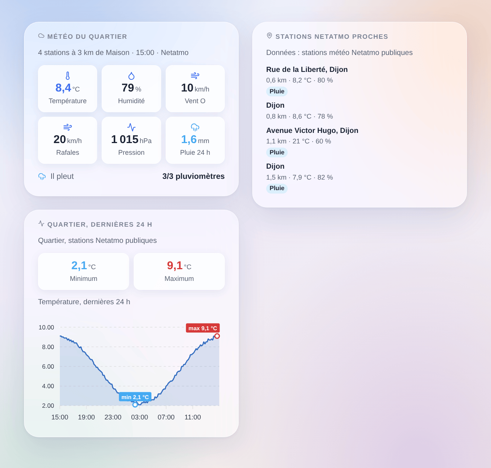

# Netatmo Public Weather

## Présentation

Des milliers de propriétaires Netatmo partagent les mesures de leur station météo. Cette intégration lit les stations publiques autour d’une maison de Gladys et en fait la météo de votre quartier : température, humidité, pression, pluie, vent. Elle prévient vos scènes quand la pluie commence ou s’arrête autour, et affiche les stations les plus proches sur le tableau de bord. Aucun appareil Netatmo n’est nécessaire.

## Prérequis

- Gladys Assistant 5.3.0 ou plus récent.
- Une maison avec une position dans Gladys (Paramètres → Maisons).
- Un compte Netatmo gratuit et votre propre application Netatmo Connect.

### Créer une application Netatmo

1. Ouvrez https://dev.netatmo.com/apps/createanapp#form et connectez-vous avec un compte Netatmo (créez-en un au besoin).
2. Remplissez les champs obligatoires : nom (par ex. « Gladys »), description, vos nom et e-mail. Laissez vides « Redirect URI » et « Webhook URI ».
3. Enregistrez : la page affiche un « client ID » et un « client secret ».

Si vous utilisez déjà l’intégration Netatmo de Gladys, créez une deuxième application pour celle-ci : chaque intégration garde ses propres jetons.

## Configuration

1. Intégrations → Netatmo Public Weather → Configuration : collez le client ID et le client secret, puis cliquez sur **Enregistrer la configuration**.
2. Cliquez sur **Connecter** à côté de « Compte Netatmo », connectez-vous chez Netatmo et acceptez (Gladys demande seulement à lire des données météo). Le statut passe à connecté. Si Netatmo refuse l’adresse de redirection, collez celle que Gladys affiche dans « Redirect URI » de votre application.
3. Choisissez la maison, le rayon (1 à 20 km, 3 par défaut : 2 à 5 km suffisent en ville, élargissez à la campagne), la façon de combiner les stations (la médiane ignore une station mal placée), le nombre de stations proches proposées comme appareils et l’intervalle de lecture (10 minutes recommandées : une requête par lecture).
4. Appuyez sur **Lire Netatmo maintenant** pour vérifier : la météo du quartier s’affiche.

## Utilisation

### Appareils

Dans la découverte, ajoutez **Météo Netatmo autour de …** : température, humidité, pression (niveau de la mer), pluie de la dernière heure et sur 24 heures, vent, rafale, direction, « Il pleut » (oui quand un tiers des pluviomètres autour mesurent de la pluie) et le nombre de stations utilisées. Ajoutez les stations proches que vous voulez : chacune donne les mesures de ses modules et sa distance de la maison. Une valeur que Netatmo ne donne pas n’est pas affichée.

### Widgets du tableau de bord

- **Météo du quartier** : pluie ou non, température, humidité, vent, rafales, pression, pluie sur 24 heures.
- **Stations Netatmo proches** : les stations les plus proches avec leur distance et leurs mesures.
- **Quartier, dernières 24 h** : un graphique de la température, de l’humidité, de la pression, du vent ou de la pluie (réglage), avec ses valeurs extrêmes. Il se remplit pendant la première journée.

### Scènes

- Déclencheurs **Netatmo : la pluie commence autour** et **Netatmo : la pluie s’arrête autour** (après deux lectures sèches de suite, pour qu’une accalmie entre deux averses ne compte pas comme une fin). Leurs variables : pluie sur 1 h et 24 h, pluviomètres, température, un résumé tout prêt.
- Action **Netatmo : lire la météo du quartier** : lit les stations maintenant, avec le rayon de votre choix, et donne les valeurs et un résumé aux actions suivantes.

Exemples : quand la pluie commence autour, fermer le Velux et envoyer le résumé ; quand elle s’arrête, reprendre l’arrosage ; chaque soir, lire la météo et prévenir du gel sous 1 °C.

### Transport

Cloud : l’intégration appelle api.netatmo.com en HTTPS. Netatmo reçoit un rectangle autour de votre maison et votre jeton d’accès. Les jetons restent dans la configuration de Gladys ; ils ne sont jamais écrits dans les journaux.

## Dépannage

- **« Saisissez l’identifiant et le secret »** : enregistrez les deux champs avant de cliquer sur Connecter.
- **« Netatmo a refusé la connexion »** : vérifiez le client ID et le secret (une copie avec une espace, une application supprimée), puis cliquez à nouveau sur Connecter. Netatmo refuse aussi quand l’accès a été révoqué depuis votre compte Netatmo.
- **« Aucune maison de Gladys n’a de position »** : renseignez-la dans Paramètres → Maisons.
- **Aucune station** : élargissez le rayon. Les stations hors ligne depuis plus d’une heure ne sont pas utilisées.
- **« Netatmo limite les requêtes »** : Netatmo autorise 500 requêtes par heure et par compte ; un autre outil qui utilise le même compte peut les épuiser. L’intégration réessaie dans 15 minutes.
- Pour signaler un problème, ouvrez une issue avec les versions de Gladys et de l’intégration, le rayon et le message de **Lire Netatmo maintenant**. Ne collez jamais votre client secret.
